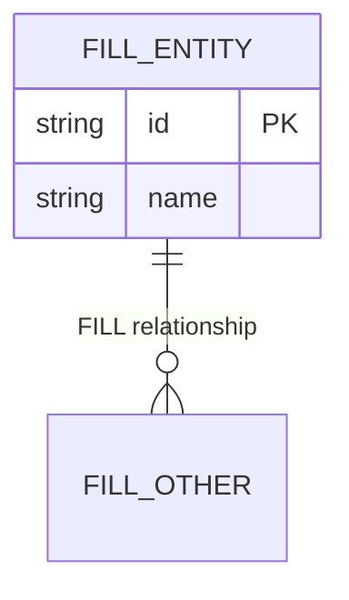

# ${title}

Entity-relationship model as a living doc. Use Mermaid `erDiagram` (https://mermaid.js.org/syntax/entityRelationshipDiagram.html); see toolkit/.ai-agents/references/diagram-authoring.md.

<abstract>

<!-- FILL: two to four sentences. Which domain this models and what a reader can decide from it. -->

</abstract>

<context>

## Context

<!-- FILL: bounded context, ownership, and links to SPEC when present. -->

</context>

<model>

## Model

<!-- FILL: Mermaid erDiagram plus short entity notes. Read current Mermaid ER syntax before editing. -->

### Entity notes

| Entity | Meaning | Keys |
|--------|---------|------|
| FILL | FILL | FILL |

</model>

<verification>

## Verification

<!-- FILL: how the model is checked (review, migration alignment, or render note). -->

| ID | Criterion | How it is checked |
|----|-----------|-------------------|
| SC1 | FILL: erDiagram renders or is marked UNVERIFIED | FILL: renderer or UNVERIFIED note |

</verification>

<open_questions>

## Open questions

- FILL: one unknown per item, or "None."

</open_questions>

<revisions>

## Revisions

Appended by `ultragentic docs revise <this file> "<what changed>"`. Do not edit dates by hand.

| Date | Change |
|------|--------|
| ${date} | Created. |

</revisions>
